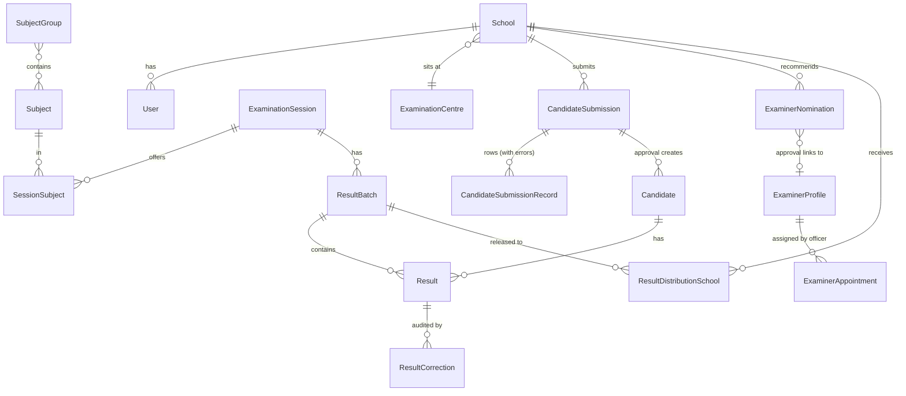

# ACEITEKA EBMIS: Architecture and Plan

*Status: Stage 2 plan. Sections marked **(built)** exist in code today. Everything else is planned.*

## 1. Stack
| Layer | Choice |
|---|---|
| Frontend | React + Vite, Tailwind CSS, React Router, Lucide icons, React Hook Form + Zod |
| Backend | Node.js + Express 4 (REST, ES modules) **(built)** |
| Database | PostgreSQL via Prisma 6 **(built)**. In development an embedded PostgreSQL runs on port 5433 (`npm run dev:db`), so Docker is not required. Production uses a normal PostgreSQL server. |
| Auth | Password hashing with bcrypt (cost 12), JWT in an HttpOnly, SameSite=Lax cookie, 8h expiry **(built)** |
| Files (planned) | Private storage on disk or S3-compatible. Never served from public URLs. Downloads go through permission-checked endpoints. |

Repository layout: `server/` (API), `client/` (web app), `design/stitch/` (the 15 Stitch mockups, reference only), root `*.md` docs.

## 2. Security model **(built unless noted)**
- Every request loads the user, roles and permissions fresh from the database. Deactivating an account or changing a role takes effect immediately.
- `requirePermission('results.approve')` is enforced on the server for every route. Hiding menu items is only a convenience.
- Two account types: `STAFF` and `SCHOOL`. `staffOnly` and `schoolOnly` gates sit in front of the route groups.
- **School isolation:** school routes read `schoolId` from the signed-in user's database record, never from the URL, query or body. Every school query is `where: { schoolId: req.user.schoolId }`.
- Login lockout after 5 failures, rate limiting, Helmet headers, an Origin check on state-changing requests (CSRF), Zod validation with plain-English messages, and a centralised error handler that hides internal errors.
- Append-only `ActivityLog` with no update or delete route.
- *(Planned)* file sniffing by content, not extension, plus size limits.

## 3. Data model (see `server/prisma/schema.prisma`)
The three examiner concepts and the student and results chains are kept separate on purpose.

## 4. Workflows
**Student entries:** School downloads the template, then uploads a CSV or Excel file. The server validates every row (missing fields, duplicates, unknown subjects, invalid subject groups, wrong dates). Invalid rows are shown with reasons, and the school corrects and uploads again. Status moves Not Submitted, Submitted, Under Review, then Changes Required or Approved or Rejected. A Registration Officer reviews and an approver approves. Approval creates the official `Candidate` records. Schools can never edit those afterwards.

**Examiners:** A school sends a *nomination* with documents. An Examiner Officer reviews it (Under Review, Changes Required, Approved or Rejected). Approval creates or reuses an `ExaminerProfile`, matched on national ID or email to prevent duplicates. It does **not** create an appointment. A separate, deliberate *Assign Examiners* action creates `ExaminerAppointment`.

**Results:** Results Officer enters or uploads marks (Draft), validates, and submits for check. A checker marks it Checked and submits for approval. A **different** person with `results.approve` approves it (Approved). A person with `results.release` sends it (Released). That creates one `ResultDistributionSchool` row per school, and schools are notified. Schools see only released results for their own students. Views and downloads are counted. Corrections after approval go through `ResultCorrection` with old value, new value, reason and officer. There is no public publication and no Gazette.

Separation of duties: the person who entered a batch cannot approve it, and the approver cannot be the same user who checked it.

## 5. API groups
`/api/auth` **(built)**, `/api/users`, `/api/schools` **(built: list/create)**, `/api/school-portal` **(built: profile)**, `/api/centres`, `/api/examination-sessions`, `/api/subjects`, `/api/candidate-submissions`, `/api/candidates`, `/api/examiner-nominations`, `/api/examiners`, `/api/examiner-appointments`, `/api/results`, `/api/results-distribution`, `/api/announcements`, `/api/messages`, `/api/reports`, `/api/activity-history` **(built)**, `/api/dashboard` **(built: counts)**. Responses use `{ items, total, page, pageSize }` for lists and `{ error, fields? }` for errors.

## 6. Plan
**Phase 1 (MVP), in order:** (1) foundation (done in server, client shell in progress); (2) schools, centres, sessions, subjects and groups; (3) student upload, validation, review and approval; (4) examiner nominations, profiles and assignments; (5) results chain and school distribution; (6) announcements, messages, reports and activity history screens; (7) Playwright and security pass; (8) deployment docs.

**Phase 2 (paid upgrades):** paper setting and reviewer vault, examiner invitations and availability, advanced marking and deployment, printing, secure storage and delivery tracking, full finance and invoicing, advanced discrepancy workflow, analytics, extra notification channels, integrations.

## 7. Stitch designs: what happens to each
| Design | Becomes | Phase |
|---|---|---|
| Main dashboard | Dashboard (real counts) | 1 |
| Candidate registration and import | Register Students | 1 |
| Results entry and verification | Enter Results / Check and Approve Results | 1 |
| Alphabetical register and **Gazette** | Student Register (kept). **Gazette removed**, replaced by Send Results to Schools | 1 |
| Examiner directory | Examiners | 1 |
| Schools and centres | Schools and Centres | 1 |
| Subject combinations | Subjects and Subject Groups | 1 |
| Examination cycles and analytics | Examination Sessions, Performance Reports | 1 |
| Discrepancy resolution | Resolve Results Errors (basic in Phase 1) | 1/2 |
| Internal tasks and reports | Tasks and Reports (basic) | 1/2 |
| Finance and invoicing | Finance (foundation only) | 2 |
| Paper setting vault | Phase 2 | 2 |
| Printing, strongroom, dispatch | Printing Batches, Secure Storage, Track Deliveries | 2 |
| Marking invitations and deployment | Basic *Assign Examiners* in Phase 1, rest Phase 2 | 1/2 |
| *(no design)* School portal | Designed from scratch in the same style | 1 |

The mockups use "Archdiocese of Kampala", "UCE/UACE" and similar wording, which is replaced with ACEITEKA wording throughout.

## 8. Risks and assumptions
- **Assumed, to confirm with ACEITEKA:** required student fields (registration number, full name, date of birth, gender, subjects), registration number format, mark range 0 to 100 per subject, grading scale, one result batch per session and subject, and the SMTP provider for email.
- The embedded database is for development only. Production needs managed PostgreSQL with backups.
- Email is not yet wired. In development, password reset links print to the server log.
- Excel parsing needs a library such as `exceljs` or `xlsx`, to be chosen with a file-content check.
